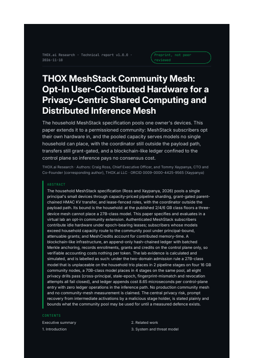

# THOX Community MeshStack Paper

[](LICENSE)
[](https://github.com/ttracx/thox-community-meshstack-paper/commits/main)
[](https://github.com/ttracx/thox-community-meshstack-paper/releases)
[](https://thox.ai)

Official THOX.ai Research paper: **THOX MeshStack Community Mesh — Opt-In User-Contributed Hardware for a Privacy-Centric Shared Computing and Distributed Inference Mesh**, by Craig Ross (Chief Executive Officer) and Tommy Xaypanya (Chief Technology Officer and Co-Founder, corresponding author, ORCID [0009-0000-4425-9565](https://orcid.org/0009-0000-4425-9565)), THOX.ai LLC.

The household MeshStack specification pools one owner's devices. This paper extends it to a permissioned community: MeshStack subscribers opt their own hardware in under epoch-bearing leases, and the pooled capacity serves models no single household can place — with the coordinator still outside the payload path, KV and activation transfers still grant-gated and principal-bound, and a blockchain-like hash-chained ledger confined to the control plane (enrollments, grants, MeshCredits) so verifiable accounting costs zero operations per token in the inference path. Status: **preprint, not peer reviewed.** Published on Zenodo: current version v1.1.0, DOI [10.5281/zenodo.24118129](https://doi.org/10.5281/zenodo.24118129) (concept DOI [10.5281/zenodo.24115595](https://doi.org/10.5281/zenodo.24115595); v1.0.0 was DOI 10.5281/zenodo.24115596). v1.1.0 is the consolidated edition: THOX Community Mesh: Unlinkable Subscriber Tokens, Digest-Audited Stage Execution and a Witness-Cosigned Settlement Ledger for Member-Contributed Inference (Craig Ross and Tommy Xaypanya), in dist/ and v1.1.0/.



## Quick start

```bash
git clone https://github.com/ttracx/thox-community-meshstack-paper.git
cd thox-community-meshstack-paper
python3 exp/community_lab.py > exp/results/summary.json   # regenerate all evidence
python3 exp/test_lab.py                                    # 5 lab tests
python3 wp/figures.py && python3 wp/build_paper.py         # rebuild figures + paper HTML
```

Open `dist/THOX_Community_MeshStack_Research_Paper_v1.0.0.pdf` to read the paper, or `dist/Community_MeshStack_Demo_v1.0.0.html` for the interactive placement demo.

## Repository layout

| Path | Contents |
|---|---|
| `dist/` | The shipped paper: PDF (reading copy), HTML, DOCX (editable copy), interactive demo HTML |
| `exp/` | The Virtual Lab: `community_lab.py` (two-domain planner, grant DAG, churn, credits, ledger), `test_lab.py`, `results/summary.json` — the single evidence source for every number in the paper |
| `wp/` | Paper build: `build_paper.py`, `figures.py`, `paper.src.html`, figures, QA report |
| `src/` | The v0.1 draft inputs the paper was developed from, kept for provenance; superseded by this edition |
| `docs/` | User guide, quickstart, development handoff, previews |
| `.agents/HANDOFF.md` | Agent handoff: status, key files, blockers, next steps |

## Documentation map

- [User Guide](docs/USER_GUIDE.md)
- [Quickstart](docs/QUICKSTART.md)
- [Development](docs/DEVELOPMENT.md)
- [Agent Handoff](.agents/HANDOFF.md)

## Releases

Formal releases live on the [Releases page](https://github.com/ttracx/thox-community-meshstack-paper/releases). The v1.0.0 release carries the paper PDF, the paper HTML and the interactive demo.

## Governance note

Public publishing (social, website, store listings, public repo flips, registries, campaigns) requires Craig Ross's explicit approval via craig@thox.ai, CC tommy@thox.ai. This repository was published on the CTO's direct order of 2026-11-10. Citation metadata is in [CITATION.cff](CITATION.cff); cite the version DOI [10.5281/zenodo.24118129](https://doi.org/10.5281/zenodo.24118129).

## License

Apache License 2.0 — see [LICENSE](LICENSE) and [NOTICE.md](NOTICE.md). The paper text is © 2026 THOX.ai LLC; citation per CITATION.cff.

Your AI. Your Data. Your Rules.™
