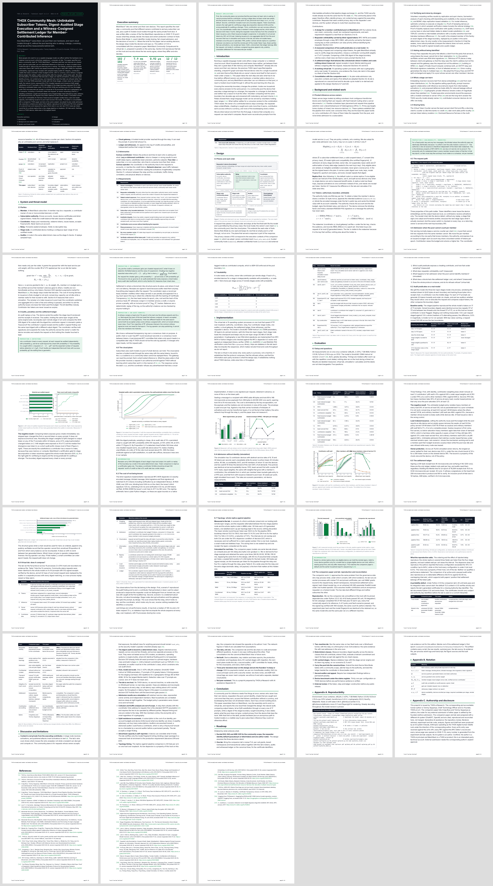

# THOX Community Mesh: research paper and virtual lab (v1.1.0)


**THOX Community Mesh: Unlinkable Subscriber Tokens, Digest-Audited Stage Execution and a Witness-Cosigned Settlement Ledger for Member-Contributed Inference.** THOX.ai Research technical report v1.1.0, 2026-11-10. Corresponding author: Tommy Xaypanya. Preprint, not peer reviewed. Internal until the founders authorise release.

**Your AI. Your Data. Your Rules.™**



## What is here

| Path | Contents |
|---|---|
| `dist/THOX_Community_Mesh_Paper_v1.1.0.pdf` | The paper (Letter, cover plus body) |
| `dist/THOX_Community_Mesh_Paper_v1.1.0.html` | Standalone HTML with embedded fonts and KaTeX |
| `dist/THOX_Community_Mesh_Demo_v1.1.0.html` | Browser demo: RFC 9474 blind tokens with known-answer tests, audit calculator, tier admission, Merkle ledger with witnesses, lab evidence |
| `lab/` | The virtual lab: 15 processes, 12 scenarios, `lab/evidence/evidence.json` |
| `companion/` | The companion lab (ChatGPT lane) as received, its authors' retained results, and this host's reproduction of its 62 tests and 150-trial campaign |
| `exp/` | Experiments, raw results, `results/summary.json` (single source of every number) |
| `wp/` | Reference fetch, figures, paper build, render, PDF, demo build, QA |
| `docs/` | User guide, quick start, development handoff, lane handoffs, ecosystem map, decision log, validation report |
| `.agents/HANDOFF.md` | Agent pickup file |

## Headline results

| Result | Value | Evidence class |
|---|---|---|
| Cheated requests exposed by a boundary-digest audit | 102 / 102 | measured, SmolLM2-135M-Instruct, 2 vCPU host |
| Cheated requests exposed by a token-exact audit | 69 / 102 (fp16 weights: 0 / 17) | measured |
| Mint one unlinkable token, RSA-2048 | 7.9 ms (verify 0.12 ms) | measured; RFC 9474 A.3 vector reproduced |
| Ledger cost per receipt at 16,384 per epoch | 0.92 microseconds; proof 448 bytes | measured |
| Virtual lab scenarios passed | 12 / 12; 8 / 8 requests token-exact | virtual lab, one host |
| Whole replica against two-stage pipeline, remote round trip per token | 124.4 ms against 134.5 ms, 30 trials each | virtual lab, loopback |
| Companion lab reproduced on this host | 62 / 62 tests; 150 / 150 trials numerically equal; 164 receipts verified | reproduction, Python 3.12 |
| Load-indexed issuance, served tokens at 0.6 load | 1.91 M against 1.91 M for least-served-first | simulated, 30 seeds |
| Fixed issuance budget, served tokens at 0.6 load | 28% fewer than least-served-first | simulated, 30 seeds |

No THOX device, wide-area or throughput result is claimed. The community plane gives identity privacy, not content privacy against the contributor that executes a stage.

## Quick start

```
pip install torch --index-url https://download.pytorch.org/whl/cpu
pip install transformers safetensors cryptography numpy matplotlib pypdf pillow
python3 -m lab.run_lab          # exit code 0 only if every scenario passes
python3 exp/analyze.py && python3 wp/figures.py && python3 wp/build.py
```

Full reproduction is in [docs/QUICKSTART.md](docs/QUICKSTART.md). Commands there ran on 2026-11-10.

## Docs map

- [User guide](docs/USER_GUIDE.md), [Quick start](docs/QUICKSTART.md), [Development handoff](docs/DEVELOPMENT.md)
- [Lane handoffs](docs/HANDOFFS.md), [Ecosystem map](docs/ecosystem_map.md), [Decision log](docs/DECISION_LOG.md), [Validation report](docs/VALIDATION.md), [Development queue](docs/DEVELOPMENT_QUEUE.md)
- [Agent pickup](.agents/HANDOFF.md)
- Releases: https://github.com/ttracx/thox-meshstack-inference/releases (no release is cut for this pack; a preprint is not a shipped version).

## License

Code: Apache-2.0. Paper text and figures: CC BY 4.0. See [LICENSE](LICENSE) and [NOTICE.md](NOTICE.md). THOX, ThoxOS, MeshStack and ThoxWork are trademarks of THOX.ai LLC.
