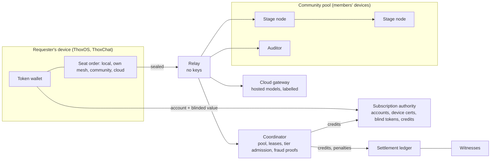

# ecosystem_map.md

Parent product: MeshStack (private distributed tier of the ThoxOS, MeshStack, ThoxWork platform model).

| Direction | Component | Contract |
|---|---|---|
| Upstream | Auto Device Role Mode (meshstack-backend, sadie-mesh) | advertisement, lease, owner protection; this design adds a community scope |
| Upstream | meshstack-desktop exact-ID model sharing, ADR-025 | only approved local models are advertised; cloud tags never |
| Upstream | thox-meshstack-inference stage engine, D25, D31 | stage execution and the determinism envelope the audit depends on |
| Downstream | ThoxChat, ThoxOS, ThoxWork | plane label on every response; privacy class on every request |
| Data boundary | authority | knows accounts; never sees tokens or requests |
| Data boundary | coordinator, relay, ledger | never see accounts or prompts |
| Data boundary | stage nodes, auditor | see activations (invertible); never accounts |
| Data boundary | cloud gateway | sees the prompt; never the account |
